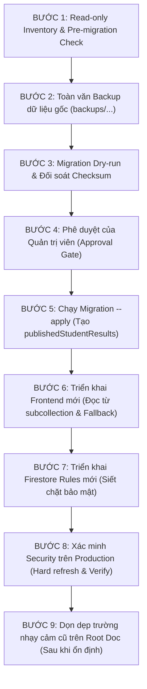

# TÀI LIỆU KIỂM KÊ DỮ LIỆU VÀ KẾ HOẠCH BẢO MẬT & MIGRATION FIRESTORE
# (FIRESTORE SECURITY HARDENING & MIGRATION SPECIFICATION)

> **Dự án:** IFA-GRADUATION  
> **Workspace:** `C:\Code\IFA-GRADUATION`  
> **Mục tiêu:** Loại bỏ hoàn toàn nguy cơ rò rỉ điểm số, phiếu chấm nội bộ và biên bản thảo luận Hội đồng từ `graduationRounds/{roundId}`.  
> **Phiên bản:** 1.0 (Phase Security Hardening)  
> **Trạng thái:** SOURCE IMPLEMENTED — EMULATOR TESTED — MIGRATION PREPARED — PENDING PRODUCTION APPROVAL

---

## 1. TỔNG QUAN VÀ BỐI CẢNH AN NINH

### 1.1. Lỗ hổng bảo mật gốc
Trên Firestore, quy tắc bảo mật hiện tại áp dụng cho root document đợt đồ án:
```text
match /graduationRounds/{roundId} {
  allow read: if signedIn();
}
```
Do Firestore **không hỗ trợ lọc trường (field-level security)** trong cùng một document, bất kỳ người dùng nào đăng nhập hệ thống (bao gồm cả Sinh viên và Khách vãng lai) đều có thể tải toàn bộ tài liệu `graduationRounds/{roundId}` về trình duyệt thông qua Firestore SDK hoặc DevTools Network/Console.

### 1.2. Hậu quả rò rỉ nếu lưu trữ trực tiếp trên Root Document
Nếu các trường điểm số được lưu trên root document hoặc lồng trong mảng `activities`:
1. **Rò rỉ điểm số chi tiết:** Sinh viên có thể xem điểm số quy đổi dạng thập phân (ví dụ: `7.33`, `8.25`) thay vì chỉ điểm chữ chính thức (`B`, `A-`).
2. **Rò rỉ kết quả trước thời hạn:** Sinh viên có thể biết điểm chốt của Hội đồng ngay khi thư ký/chủ tịch bấm chốt, trước khi Quản trị viên/Ban chủ nhiệm chính thức công bố.
3. **Rò rỉ chéo giữa các sinh viên:** Sinh viên A có thể xem được toàn bộ điểm số, xếp loại của Sinh viên B và các sinh viên khác trong cùng đợt.
4. **Rò rỉ phiếu chấm cá nhân của Giảng viên:** Sinh viên có thể xem từng thành viên hội đồng chấm bao nhiêu điểm, nhận xét riêng tư nội bộ của từng thầy/cô.
5. **Rò rỉ điểm sau khi thu hồi:** Nếu Quản trị viên thu hồi công bố nhưng điểm vẫn còn nằm trong document public, sinh viên vẫn đọc được dữ liệu.

---

## 2. BẢNG KIỂM KÊ DỮ LIỆU NHẠY CẢM (DATA INVENTORY)

| STT | Vị trí lưu trữ hiện tại | Tên trường / Cấu trúc dữ liệu | Mức độ nhạy cảm | Module đang ĐỌC | Module đang GHI | Đối tượng được phép đọc thực tế | Cấu trúc mới mục tiêu (Phân tách) |
| :---: | :--- | :--- | :---: | :--- | :--- | :--- | :--- |
| **1** | `graduationRounds/{roundId}` | `councilScores` (Map điểm thành viên) | **NGHIÊM NGẶT** | `rubrics-workspace.js`, `defense-scores.js` | `rubrics-scoring.js` (legacy cache), `preliminary-dashboard.js` (điều chỉnh) | Admin, Thành viên HĐ được phân công | Subcollection `councilScores/{scoreId}` hoặc `reviewDecisions/{decisionId}` |
| **2** | `graduationRounds/{roundId}` | `progressReviews` (Map kết quả duyệt 1/2/3) | **NGHIÊM NGẶT** | `preliminary-dashboard.js`, `assessment-portal.js` | `defense-scores.js`, `preliminary-entry.js` | Admin, Thành viên HĐ của đợt | Subcollection `reviewDecisions/{decisionId}` (bản chốt `_official`) |
| **3** | `graduationRounds/{roundId}` $\rightarrow$ `activities[].councils[]` | `finalDefenseScores` (Điểm chốt HĐ lồng nhau) | **NGHIÊM NGẶT** | `preliminary-dashboard.js`, `final-scores-ranking.js` | `defense-scores.js`, `preliminary-dashboard.js` | Admin, Chủ tịch HĐ, Thành viên HĐ | Subcollection `reviewDecisions` / `councilScores` (Tách khỏi `activities[]`) |
| **4** | `graduationRounds/{roundId}` | `publishedReviews.*.studentResults` (Danh sách điểm công bố của toàn bộ SV) | **TRUNG BÌNH** (Chỉ được xem điểm của mình sau công bố) | `student-journey.js`, `rounds-timeline-preview.js`, `supervisor-portal-students.js` | `preliminary-dashboard.js` (confirmPublish) | Từng Sinh viên (chỉ bản thân), GVHD (chỉ SV mình hướng dẫn), Admin | Subcollection `publishedStudentResults/{studentId}` (Root doc CHỈ giữ cờ `status`, `publishedAt`) |
| **5** | `graduationRounds/{roundId}/reviewDecisions/{decisionId}` | Phiếu chấm cá nhân, điểm rubric, nhận xét | **NGHIÊM NGẶT** | `rubrics-workspace.js`, `defense-scores.js`, `assignments-admin.js` | `rubrics-scoring.js`, `preliminary-entry.js` | Admin, Thành viên chấm, Chủ tịch HĐ khi kết thúc | Subcollection `reviewDecisions` (Giữ nguyên vị trí nhưng siết chặt Rules chặn staff ngoài HĐ) |
| **6** | `graduationRounds/{roundId}/councilScores/{scoreId}` | Bản ghi điểm số theo slot HĐ | **NGHIÊM NGẶT** | `rubrics-workspace.js` | `defense-scores.js` | Admin, Thành viên chấm, Chủ tịch HĐ | Subcollection `councilScores` (Bảo toàn) |

---

## 3. KIẾN TRÚC PHÂN TÁCH DỮ LIỆU 3 TẦNG (3-TIER DATA ARCHITECTURE)

```mermaid
flowchart TD
    subgraph TierA["TẦNG A: ROUND METADATA (graduationRounds/{roundId})"]
        direction TB
        A1["Tên đợt, năm học, mô tả"]
        A2["Cấu hình mốc: activities (Đã loại bỏ hoàn toàn finalDefenseScores)"]
        A3["Lịch trình, Deadline nộp bài"]
        A4["Cờ công bố: publishedReviews.duyet_X = { status: 'published'/'revoked', publishedAt, isPublished: bool }"]
        A5["NGHIÊM CẤM: Không chứa điểm số, phiếu chấm, nhận xét cá nhân, hoặc map studentResults"]
    end

    subgraph TierB["TẦNG B: PRIVATE GRADING STORAGE (Subcollections)"]
        direction TB
        B1["graduationRounds/{roundId}/reviewDecisions/{decisionId}"]
        B2["graduationRounds/{roundId}/councilScores/{scoreId}"]
        B3["graduationRounds/{roundId}/publishedProgressReviews/{phaseId} (Admin Snapshot)"]
        B4["auditLogs/{logId} (Nhật ký điều chỉnh điểm và thu hồi)"]
        B5["Quyền truy cập: Admin/Owner toàn quyền; Thành viên HĐ CHỈ xem/chấm HĐ mình được phân công"]
    end

    subgraph TierC["TẦNG C: PUBLISHED STUDENT RESULTS (graduationRounds/{roundId}/publishedStudentResults/{studentId})"]
        direction TB
        C1["Định danh: studentId"]
        C2["reviews.duyet_1: { phase: 1, letterGrade: 'B', isPassed: true, status: 'published', publishedAt }"]
        C3["reviews.duyet_2: { phase: 2, letterGrade: 'A', isPassed: true, status: 'published', publishedAt }"]
        C4["Trạng thái công bố: status = 'published' | 'revoked', isPublished = true | false"]
        C5["Quyền truy cập: Từng SV (chính mình), GVHD (SV được phân công), Admin/Owner"]
        C6["Ràng buộc: BỊ TỪ CHỐI TRUY CẬP ngay tại Rules nếu status == 'revoked' hoặc chưa công bố"]
    end

    TierA -->|Tham chiếu hiển thị mốc| TierC
    TierB -->|Hành động Công bố| TierC
    TierB -->|Hành động Thu hồi| TierC
```



### 3.1. Tầng A – Round Metadata (`graduationRounds/{roundId}`)
- Mục đích: Cung cấp thông tin lịch trình, quy định, danh sách mốc cho toàn thể sinh viên và giảng viên.
- Nguyên tắc: Hoàn toàn không chứa dữ liệu nhạy cảm.
- Trường `publishedReviews`:
  ```json
  {
    "publishedReviews": {
      "duyet_1": {
        "status": "published",
        "isPublished": true,
        "phase": 1,
        "activityId": "act_1790171285992_yhhi9",
        "publishedAt": "2026-10-16T08:00:00.000Z",
        "publicationVersion": 1
      }
    }
  }
  ```
  *(Tuyệt đối không lưu mảng hoặc map `studentResults` bên trong document này).*

### 3.2. Tầng B – Private Grading Storage (Subcollections)
- `reviewDecisions/{decisionId}`:
  Lưu phiếu chấm của từng thành viên hội đồng.
  Khóa định danh: `{activityId}_{councilId}_{studentId}_{scorerEmail}` (hoặc `{scorerId}`).
  Khóa chốt điểm Hội đồng: `{activityId}_{councilId}_{studentId}_official`.
- `councilScores/{scoreId}`:
  Khóa: `{activityId}_{councilId}_{studentId}_{scorerId}`.
- `publishedProgressReviews/{phaseId}`:
  Bản lưu snapshot tổng thể của Quản trị viên phục vụ tổng kết và đối soát.

### 3.3. Tầng C – Published Student Results
Đường dẫn: `graduationRounds/{roundId}/publishedStudentResults/{studentId}`
Cấu trúc hỗ trợ đa mốc duyệt (Duyệt 1, Duyệt 2, Duyệt 3 không ghi đè nhau):
```json
{
  "studentId": "11900382",
  "studentName": "Trang Trần Tuệ Nhã",
  "roundId": "FZRWniqMofaIvn7ogq0w",
  "status": "published",
  "isPublished": true,
  "reviews": {
    "duyet_1": {
      "phase": 1,
      "activityId": "act_1790171285992_yhhi9",
      "letterGrade": "B",
      "isPassed": true,
      "status": "published",
      "publishedAt": "2026-10-16T08:00:00.000Z",
      "publicationVersion": 1
    },
    "duyet_2": {
      "phase": 2,
      "activityId": "act_duyet_2",
      "letterGrade": "A",
      "isPassed": true,
      "status": "published",
      "publishedAt": "2026-11-20T08:00:00.000Z",
      "publicationVersion": 1
    }
  },
  "updatedAt": "2026-10-16T08:00:00.000Z"
}
```

---

## 4. MA TRẬN PHÂN QUYỀN VÀ THIẾT KẾ FIRESTORE RULES

### 4.1. Ma trận phân quyền theo vai trò (RBAC Matrix)

| Tài nguyên / Hành động | Sinh viên sở hữu | Sinh viên khác | GVHD được phân công | GVHD không phân công | Ủy viên HĐ (trong HĐ) | Giảng viên ngoài HĐ | Quản trị viên / Chủ sở hữu |
| :--- | :---: | :---: | :---: | :---: | :---: | :---: | :---: |
| Đọc `graduationRounds/{roundId}` (Metadata) | Cho phép | Cho phép | Cho phép | Cho phép | Cho phép | Cho phép | Cho phép |
| Đọc `publishedStudentResults/{studentId}` (Đang Published) | **Cho phép** | Bị chặn | **Cho phép** | Bị chặn | Bị chặn (trừ khi là GVHD) | Bị chặn | **Cho phép** |
| Đọc `publishedStudentResults/{studentId}` (Đã Revoked) | **Bị chặn** | Bị chặn | **Bị chặn** | Bị chặn | Bị chặn | Bị chặn | **Cho phép** |
| List toàn bộ `publishedStudentResults` | Bị chặn | Bị chặn | Bị chặn | Bị chặn | Bị chặn | Bị chặn | **Cho phép** |
| Đọc phiếu chấm `reviewDecisions` của mình | Bị chặn | Bị chặn | Bị chặn | Bị chặn | **Cho phép** | Bị chặn | **Cho phép** |
| Đọc phiếu chấm `reviewDecisions` của người khác | Bị chặn | Bị chặn | Bị chặn | Bị chặn | Chỉ khi là Chủ tịch (sau chốt) | Bị chặn | **Cho phép** |
| Ghi/Sửa phiếu chấm `reviewDecisions` | Bị chặn | Bị chặn | Bị chặn | Bị chặn | **Cho phép** (trước khi chốt) | Bị chặn | **Cho phép** |
| Điều chỉnh điểm / Công bố / Thu hồi | Bị chặn | Bị chặn | Bị chặn | Bị chặn | Bị chặn | Bị chặn | **Cho phép (Admin)** |

### 4.2. Cấu hình Firestore Rules mục tiêu
```text
// 1. Phân quyền kết quả công bố cho từng sinh viên
match /publishedStudentResults/{studentId} {
  function isResultPublished(data) {
    return (
      (data.status == 'published' || data.isPublished == true)
      && data.status != 'revoked'
    ) || (
      data.keys().hasAll(['reviews']) && (
        (data.reviews.keys().hasAll(['duyet_1']) && data.reviews.duyet_1.status == 'published')
        || (data.reviews.keys().hasAll(['duyet_2']) && data.reviews.duyet_2.status == 'published')
        || (data.reviews.keys().hasAll(['duyet_3']) && data.reviews.duyet_3.status == 'published')
      )
    );
  }

  function isAssignedSupervisor(stId) {
    return (
      exists(/databases/$(database)/documents/graduationRounds/$(roundId)/officialAssignments/$(stId))
      && get(/databases/$(database)/documents/graduationRounds/$(roundId)/officialAssignments/$(stId)).data.assignmentStatus == 'published'
      && (email() in get(/databases/$(database)/documents/graduationRounds/$(roundId)/officialAssignments/$(stId)).data.supervisorEmails
        || email().lower() in get(/databases/$(database)/documents/graduationRounds/$(roundId)/officialAssignments/$(stId)).data.supervisorEmails)
    ) || (
      exists(/databases/$(database)/documents/graduationRounds/$(roundId)/supervisorAssignments/$(stId))
      && (email() in get(/databases/$(database)/documents/graduationRounds/$(roundId)/supervisorAssignments/$(stId)).data.supervisorEmails
        || email().lower() in get(/databases/$(database)/documents/graduationRounds/$(roundId)/supervisorAssignments/$(stId)).data.supervisorEmails)
    );
  }

  // Từng SV và GVHD CHỈ đọc được tài liệu cụ thể (getDoc) khi kết quả ĐANG CÔNG BỐ
  allow get: if admin()
    || (student() && email().matches('(?i)^' + studentId + '@student\\.tdtu\\.edu\\.vn$') && isResultPublished(resource.data))
    || (staff() && isAssignedSupervisor(studentId) && isResultPublished(resource.data));

  // Nghiêm cấm list/query duyệt toàn bộ sinh viên, chỉ Admin mới được list
  allow list: if admin();

  // Chỉ Admin được ghi/sửa/xóa kết quả công bố
  allow create, update, delete: if admin();
}

// 2. Snapshot công bố mốc của Quản trị viên
match /publishedProgressReviews/{phaseKey} {
  allow get, list, write: if admin();
}
```

---

## 5. CƠ CHẾ THU HỒI CÔNG BỐ VÀ ĐIỀU CHỈNH ĐIỂM AN TOÀN

### 5.1. Cơ chế Thu hồi công bố (Revocation)
1. **Thay đổi nguồn dữ liệu có thẩm quyền:**
   - Cập nhật root document: `publishedReviews.duyet_1 = { status: 'revoked', isPublished: false, revokedAt: ..., revokeReason: ... }`.
   - Cập nhật từng tài liệu `publishedStudentResults/{studentId}`:
     - `reviews.duyet_1.status = 'revoked'`
     - `reviews.duyet_1.isPublished = false`
     - `status = 'revoked'`
     - `isPublished = false`
2. **Chặn đọc ở tầng Firestore Rules:**
   - Ngay khi `status == 'revoked'`, hàm `isResultPublished()` trả về `false`.
   - Mọi yêu cầu `getDoc` từ Sinh viên hoặc GVHD bị Firestore Rules **từ chối ngay lập tức (`PERMISSION_DENIED`)**.
3. **Bảo toàn dữ liệu nội bộ:**
   - Phiếu chấm gốc trong `reviewDecisions` và snapshot trong `publishedProgressReviews` không bị xóa.
   - Ghi audit log vào `auditLogs` với hành động `REVOKE_PROGRESS_REVIEW_PUBLISH`.

### 5.2. Cơ chế Điều chỉnh điểm (Score Adjustment)
1. **Điều kiện tiên quyết:**
   - Chỉ Admin hoặc Owner mới có quyền.
   - Bắt buộc nhập Căn cứ họp / Số biên bản.
   - Bắt buộc nhập Lý do điều chỉnh ($\ge 10$ ký tự).
   - Nếu đợt đang công bố, bắt buộc phải Thu hồi công bố trước khi điều chỉnh.
2. **Lưu trữ điểm điều chỉnh:**
   - **Tuyệt đối không ghi đè phiếu chấm cá nhân của thành viên.** Phiếu chấm gốc của từng giảng viên được bảo toàn 100%.
   - **Tuyệt đối không ghi điểm điều chỉnh vào root document public `graduationRounds/{roundId}`.**
   - Điểm điều chỉnh được ghi vào subcollection riêng tư `reviewDecisions/{activityId}_{councilId}_{studentId}_official` (hoặc `councilScores`) kèm metadata: `{ adjusted: true, oldLetter, newLetter, basis, reason, adjustedBy, adjustedAt }`.
   - Ghi audit log bất biến vào `auditLogs` (`action: 'ADJUST_COUNCIL_SCORE'`).

---

## 6. CHIẾN LƯỢC MIGRATION PRODUCTION-SAFE

### 6.1. Nguyên tắc cốt lõi
1. **Idempotent (Khả năng chạy lại):** Chạy nhiều lần cho ra cùng một kết quả, không tạo bản ghi trùng lặp.
2. **Mặc định `--dry-run`:** Chỉ đọc và tính toán báo cáo đối soát, không ghi bất kỳ dữ liệu nào nếu thiếu cờ `--apply`.
3. **Sao lưu trước khi di chuyển (Backup first):** Tự động export toàn bộ dữ liệu trước migration ra file JSON tại `backups/firestore-security-backup-*.json`.
4. **Không làm gián đoạn hệ thống:** Không sửa đổi file Google Drive, không tăng lượt nộp bài, không thay đổi điểm số gốc của sinh viên.
5. **Có kế hoạch Rollback tường minh:** Có khả năng khôi phục nguyên trạng từ bản sao lưu nếu có sự cố.

### 6.2. Kịch bản Cutover từng bước (Production Cutover Sequence)



---

## 7. KẾ HOẠCH ROLLBACK (ROLLBACK PROCEDURE)

Nếu phát sinh sự cố trong quá trình cutover:
1. **Rollback Frontend:** Triển khai lại phiên bản Hosting trước đó qua Firebase Console (`Release previous version`) chỉ trong 30 giây.
2. **Rollback Firestore Rules:** Deploy lại file `firestore.rules` ở commit `8a17492` bằng lệnh `firebase deploy --only firestore:rules`.
3. **Rollback Dữ liệu:** Sử dụng file backup được tạo tại Bước 2 (`backups/firestore-security-backup-*.json`) và chạy script rollback `scripts/migrate-firestore-security.cjs --rollback=<backup_file>`.

---

## 8. DANH MỤC CÁC MODULE BỊ ẢNH HƯỞNG & ĐÃ ĐƯỢC ĐIỀU CHỈNH

1. `firestore.rules`: Bổ sung match `publishedStudentResults/{studentId}` và `publishedProgressReviews/{phaseKey}`, siết chặt `reviewDecisions`.
2. `js/grading/preliminary-dashboard.js`:
   - Tách rời `studentResults` khỏi root document khi công bố.
   - Ghi dữ liệu công bố phân tách theo từng sinh viên vào `publishedStudentResults/{studentId}`.
   - Thu hồi đồng bộ tại root doc và subcollection.
   - Không ghi điểm điều chỉnh vào root doc.
   - Cung cấp hàm `window.getStudentPublishedReviewResult(roundId, studentId, phase)`.
3. `js/grading/rubrics-scoring.js`: Loại bỏ ghi cache `councilScores` vào root document.
4. `js/grading/preliminary-entry.js`: Loại bỏ ghi `progressReviews` vào root document.
5. `js/grading/defense-scores.js`: Bảo vệ cấu trúc `activities` khỏi việc chứa điểm số công khai khi chốt điểm.
6. `js/students/student-journey.js`: Đọc kết quả công bố an toàn qua `getStudentPublishedReviewResult`.
7. `js/rounds/rounds-timeline-preview.js`: Đọc kết quả công bố an toàn qua `getStudentPublishedReviewResult`.
8. `js/supervisors/supervisor-portal-students.js`: Đọc kết quả công bố an toàn qua `getStudentPublishedReviewResult`.
